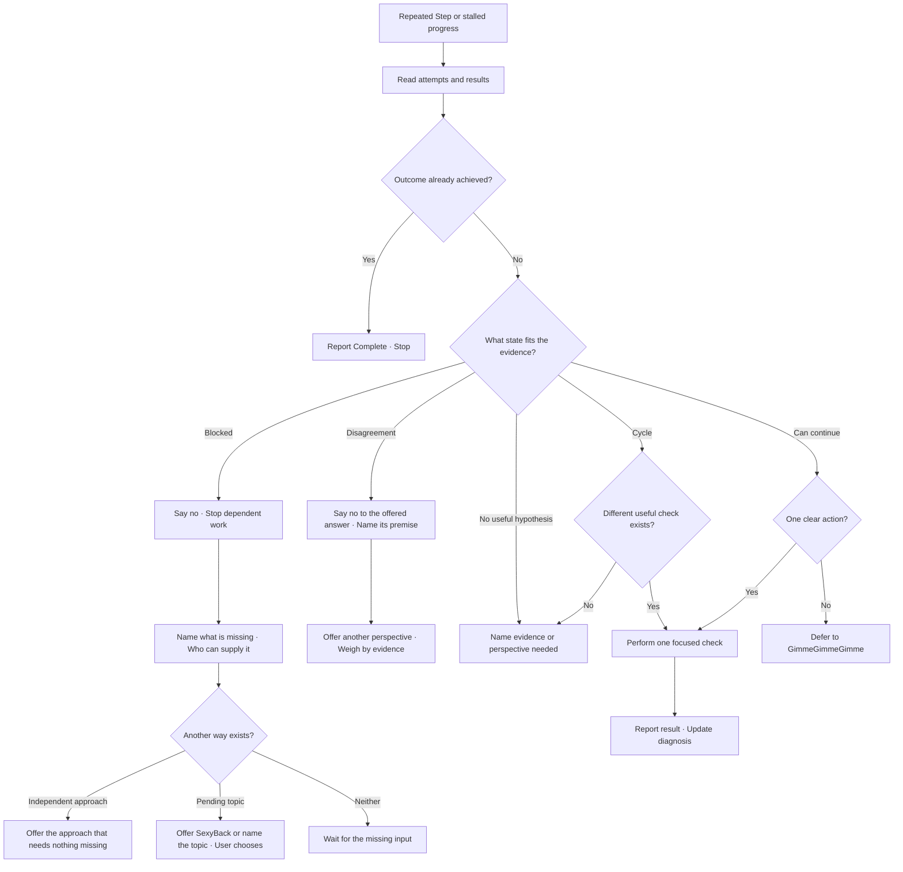

# SayNoGo

Named for De La Soul's song, *Say No Go*.
Stop what cannot go on, then make the next Movement possible:
name what is missing and offer another way.
The no can also fall on an answer: when the user disagrees
with what was offered, the skill gives another perspective.
A failed attempt is Evidence; repeating its explanation adds none.
Other skills call it when they meet a block; it also answers a direct ask.



## Read the Current Knot

Recover the active Purpose, what would count as done,
and the latest attempts with their results.
Read only the conversation and relevant artifacts;
use `.handoff.md` as supporting context after checking that it is current.
Do not substitute the original topic for the active one.

Separate Facts from hypotheses. Name what each attempt changed or taught.
When evidence is missing, make one focused, authorized check
that could change the diagnosis. Do not repeat an unchanged failed attempt.
Do not ask the user for information already available locally.

## Determine the State

Assess these questions together; a Cycle can coexist with a Blocker.

- **Complete** — the requested outcome is already achieved.
  Report the evidence and stop; no new ideas are needed.
- **Can continue** — a useful authorized action can change the result
  or distinguish live hypotheses. Name that action and what it would reveal.
- **Blocked** — progress toward the requested outcome requires a specific
  unavailable input, access, decision or external change.
  Name the dependency, the evidence and who or what can supply it.
  State any independent work still possible.
- **Disagreement** — the user rejects the answer offered
  and wants another view, not another attempt at the same one.
  Say no to that answer without defending or restating it; name the premise
  it rested on, which is what the disagreement now questions.
  Offer one other perspective: a different premise or reading,
  grounded in the same evidence. If the objection is right, say so.
  If the evidence still favors the first answer, show it and still
  offer the other view; never reverse only to please.
- **Cycle** — attempts return to the same premise, action or conclusion
  without new evidence or a changed condition.
  Point to the repeated attempts; do not diagnose a cycle merely from duration.
  Stop that repetition and identify one different observation or approach.
- **No useful hypothesis** — the considered approaches are exhausted
  and no discriminating next action can currently be named.
  Say which approaches were exhausted and what evidence or perspective
  could generate another. This does not prove the problem is impossible.

When evidence is insufficient, say what remains Unknown.
Do not call uncertainty, difficulty or one failure a confirmed blocker.
These are conversational diagnoses; do not change a managed goal's status
unless its own lifecycle requirements are satisfied.

## Open a Way Forward

On a Disagreement, the way forward is the other perspective itself.
Name the premise that changes, what that view sees and what it leaves out.
Reword nothing: a restated answer is a Cycle, not a perspective.
Let the user choose between the two views; do not pick for them.

If a focused check can break the cycle or resolve uncertainty,
name and perform that one check within existing authorization.
Report its result and update the diagnosis; do not start a retry loop.

When a dependency is required, say no to the dependent work plainly,
ask for the smallest missing input and stop. Do not work around the block
with a guess, a stub or a wider permission than was granted.
Then offer one way forward, and let the user choose:

- **Another approach** — a path that needs nothing missing,
  such as independent work that serves the same authorized purpose.
  Name what it reaches and what it leaves undone.
- **Another topic** — a pending thread the block does not touch.
  Offer [SexyBack](../sexy-back/SKILL.md) when that thread is the Origin;
  otherwise name the topic and its state.

Offer an approach only when one is real; never invent one to soften the no.

When no useful hypothesis remains, identify the kind of help needed:
a concrete example, another observation, domain knowledge or a fresh reading.
Request delegation only when authorized; do not invent a new idea to fill a slot.
When returning to the Origin would help, offer
[SexyBack](../sexy-back/SKILL.md) with the topic; let the user choose.

## Return the Diagnosis

Use the conversation's language and ordinary capitalization.
Keep the result to the state, its evidence and what makes progress possible.
For example:

```text
Estamos en un ciclo: repetimos la misma consulta con el mismo resultado.
Falta comprobar si el archivo leído es el que usa el proceso.
Comprobé la ruta activa: apunta a otra copia. Podemos continuar desde allí.
```

```text
Estamos bloqueados: no podemos publicar, falta la credencial del mantenedor y nadie más la tiene.
Mientras llega, puedo dejar listo el changelog, que no la necesita.
O volvemos al tema original, la migración, si prefieres.
```

If the user disagreed, answer in three beats: the no to the offered answer,
the premise it rested on, and the other perspective with its evidence.
If blocked, answer in three beats: the no, what is missing,
and the way forward. The no says plainly that we are blocked. Say exactly what is needed, who can supply it
and how its arrival would unblock work.
If no blocker was found, say so with the next useful action.
Checkpoint a durable change or a diagnosis that changes the next step through
[RememberTheDay](../remember-the-day/SKILL.md).
A conversation-only assessment needs no checkpoint.
