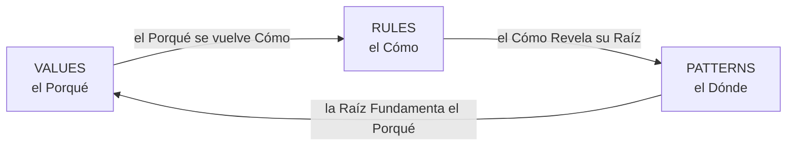
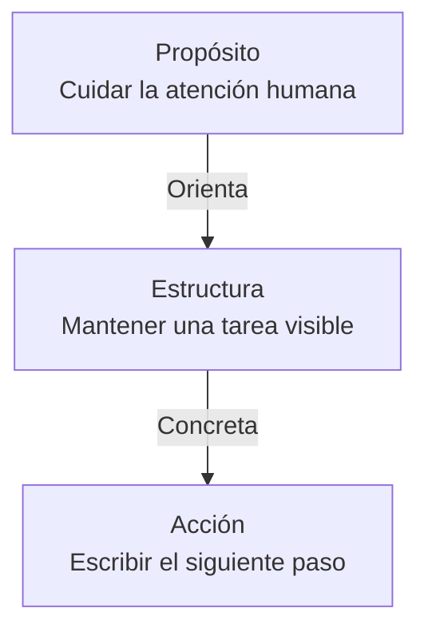
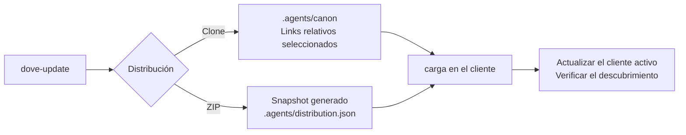
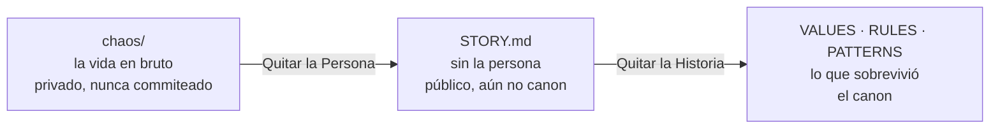

# Dove Canon

[English](README.md)

Dove Canon es un Harness para el Trabajo compartido entre una Persona y un
Agente. Protege la atención humana de tres maneras: mantiene pequeño el
siguiente Paso, mantiene el Estado fuera de la mente y mantiene la Máquina
dentro de su Autoridad.

No intenta usar toda Capacidad, cubrir todo Caso ni automatizar toda Decisión.
**Más es un Costo antes que una Función.**

Este Repositorio es a la vez un Manifiesto y una Base de código. Las Reglas
dicen cómo un Agente debe leer, escribir y colaborar aquí. Los Valores y
Patrones guardan las razones, para que una Persona pueda inspeccionarlas y
cuestionarlas.

El Harness está hecho para volverse innecesario. Lo que queda es el Aprendizaje.

Esta Página es la entrada técnica a Dove Canon. La
[Presentación](docs/presentation.es.md), más larga, explica por qué existen las
ideas; esta Página muestra la Arquitectura, las operaciones y los chequeos que
las vuelven concretas. Los documentos enlazados están en inglés, salvo la
Presentación.

## Empieza por el Canon o por el Código

- Para entender el Manifiesto, lee [Values](VALUES.md), [Rules](RULES.md) y
  [Patterns](PATTERNS.md).
- Para trabajar como Agente, empieza en [AGENTS.md](AGENTS.md) y luego lee
  [Rules](RULES.md).
- Para ver las Reglas en ejecución, abre el
  [servicio School](examples/school/README.md) o el
  [conversor PDF](examples/pdf/README.md).
- Para conectar otro proyecto, usa
  [dove-update](.agents/skills/dove-update/SKILL.md).

## Un Harness Mantiene el Trabajo Retomable

El Harness tiene tres trabajos: preservar el Contexto entre sesiones
desechables, acotar lo que un Agente puede hacer a continuación y convertir la
experiencia repetida en un Canon inspeccionable.

```text
Persona      aporta Intención, criterio y autoridad
Harness      guarda Contexto, reglas, operaciones y límites
Agente       lee el estado actual y da un Paso verificable
```

Una sesión normal se mantiene deliberadamente pequeña:

```text
yo-yo-yo          reconstruye el Contexto y nombra un siguiente Paso
gimme-gimme-gimme      presenta hasta tres caminos y espera una elección
next-episode      ejecuta ese Paso, lo verifica y se detiene
remember-the-day  persiste el Estado mientras el Trabajo avanza
bye-bye-bye       deja un handoff que otra sesión pueda retomar
```

Los proyectos se conectan al Canon mediante `dove-update`, que trata la
distribución del código fuente y la carga del cliente como operaciones
separadas. Las instalaciones existentes conservan su mecanismo de distribución:
clone, submodule, subtree, symlink o ZIP portable. La validación del filesystem
prueba la conexión; el descubrimiento del cliente prueba que el Agente la cargó.

El mismo límite vale para el conocimiento. La experiencia en bruto se queda en
`chaos/`; una observación despersonalizada puede volverse una Story; solo el
Aprendizaje que sobrevive a la revisión se vuelve un Valor, una Regla o un
Patrón. El Sistema puede generar y comparar. La Persona decide qué gobierna.

Los ejemplos vuelven ejecutables las Reglas de arquitectura. El servicio School
se genera desde un Contrato, una Especificación y una Forma que viven fuera de
su código. Sus implementaciones en Go, Java y TypeScript responden las mismas
solicitudes de la misma manera. El conversor PDF mantiene el parseo de Markdown,
la estructura del documento y el renderizado detrás de fronteras explícitas.

La meta es un Trabajo que siga siendo comprensible, interrumpible, verificable
y retomable.

## El Mapa del Repositorio Separa el Propósito de la Operación

```text
VALUES.md   el Porqué      creencias, en values/
RULES.md    el Cómo        reglas verificables, en rules/
PATTERNS.md el Dónde       raíces que se repiten, en patterns/
AGENTS.md   el Puntero     lo que un agente carga solo
.agents/    agents/ y skills/, las operaciones
examples/   school/ y pdf/, las reglas corriendo en Go; specs/ guarda lo que las genera
docs/       la Presentación, en inglés y en español
stories/    STORY.md, stories/ y chaos/: contexto, aún no canon
jokes/      humor escrito a mano; se lee, nunca se agrega
```

Tres Documentos sostienen el Manifiesto: [Values](VALUES.md), [Rules](RULES.md)
y [Patterns](PATTERNS.md). [AGENTS.md](AGENTS.md) dirige al Agente hacia el
Canon actual y le indica leer primero las Reglas.

## Main es el Único Canon

El Canon es el head de `main`, y nada más.
Los releases estables nombran snapshots útiles para distribuir; `main` sigue siendo la fuente actual.
Un proyecto que fija un release sigue un Fork. `1.0.0` es el UNTAG histórico;
`v1.0.0` es el primer release estable.
[The Head is the Canon](rules/the-head-is-the-canon.md) explica por qué.

## Tres Mantiene Visible cada Relación

El Tres sale de una cuenta, no de un gusto.
Con `n` entidades hay `n(n-1)/2` interacciones posibles, y la comprensión vive en las interacciones.

| Entidades | Interacciones | Lectura |
| --- | --- | --- |
| 1 | 0 | Atención, nada que relacionar |
| 2 | 1 | Una relación, y un extremo se vuelve centro |
| 3 | 3 | Cada par visible, y el ciclo se cierra |
| 4 | 6 | Más relaciones que cosas |
| 5 | 10 | Las relaciones dejan de ser contables |

Tres es el último conteo donde ambas columnas coinciden y el menor que cierra
un ciclo. El Número es una Fuente de la que derivar, nunca una cuota que
alcanzar.
Una situación con cuatro categorías se queda con las cuatro.
Ver [Three over Four](patterns/three-over-four.md) y [Count me In](patterns/count-me-in.md).

Tres no le pide al Sistema que haga menos porque menos sea virtuoso.
Pregunta qué debe seguir Visible para que una Persona entienda, interrumpa y continúe el Trabajo.

## Valores, Reglas y Patrones Forman un Ciclo

[RoTaTion](patterns/de-la-soul-rotation.md) conecta los tres Documentos mediante tres pares, sin centro fijo.
Se entra por cualquier Elemento y se siguen las relaciones.



Una Regla debe poder ejecutarla un Agente, o es un Valor.
Las Reglas son verificables y los Valores son interpretables.
Una Regla marcada *Provisional* salió de una sola práctica, y se borra si el siguiente proyecto la contradice.

Una segunda lectura va del Propósito a la Acción en tres Capas:



## DeLaCase Vuelve Contable el Énfasis

[DeLaCase](rules/de-la-case.md) es la Convención tipográfica para la prosa.
Una mayúscula marca una Entidad o una Interacción digna de notarse.

1. Divide el texto en pasajes según la puntuación; una viñeta o un salto de línea duro también cierra uno.
2. Gasta como máximo tres mayúsculas de énfasis por pasaje.
3. La inicial gramatical es gratis; los nombres propios y las siglas conservan su ortografía.

> La Persona Guía a la Máquina, la Máquina Apoya a la Persona.

Dos pasajes, cada uno con su propio presupuesto, cada uno gastando tres.
Tres es un techo, nunca una cuota.

El código tiene su propia regla: la capitalización de un identificador pertenece al lenguaje, y el lenguaje decide.
En Go, una mayúscula cruza la frontera del paquete y el compilador lo hace cumplir.
El texto final en una interfaz de usuario usa capitalización ordinaria.

La negrita es un segundo nivel y cuesta más: una por sección, o ninguna.
[Channels](rules/channels.md) cuenta lo que una superficie puede cargar, y [Emoji](rules/emoji.md) marca un estado, uno por línea como máximo.

## Los Ejemplos Vuelven Ejecutables las Reglas de Código

Cada regla que gobierna código corre en [examples](examples).
[Show me the Code](patterns/show-me-the-code.md) explica por qué importa.

| Regla | Afirmación que se puede comprobar |
| --- | --- |
| [Layers](rules/layers.md) | El Core no nombra ningún vendor ni socket; el compilador sostiene la frontera. |
| [Providers](rules/providers.md) | El Core declara una interfaz; un Port se nombra por la necesidad, nunca por el vendor. |
| [Shapes](rules/shapes.md) | La entidad nunca es el DTO: Wire, Business y Storage son tres tipos. |
| [Failures](rules/failures.md) | Un fallo controlado lleva su respuesta; una sola función lo mapea a un status. |
| [Constants](rules/constants.md) | Las constantes globales van separadas de la configuración y se validan al arrancar. |
| [Scripts](rules/scripts.md) | Todo programa responde `build.sh` y `run.sh`, y cada uno rechaza lo que fallaría. |
| [Entrypoints](rules/entrypoints.md) | Las puertas se declaran en una lista; un shim solo llama a la lógica. |
| [Tests](rules/tests.md) | La expectativa se escribe explícita, y luego se prueba por mutación. |
| [Naming](rules/naming.md) | Verbo + Sustantivo + contexto, tres palabras como máximo. |
| [Structure](rules/structure.md) | Tres tiempos por función, no tres saltos de línea. |

### El Servicio School

[School](examples/school/README.md) es una API generada desde un [Contrato](examples/specs/school/openapi.yaml), una [Especificación](examples/specs/school/SPEC.md) y una [Forma](examples/specs/school/SHAPE.md).
Go, Java y TypeScript se generan desde las tres fuentes y responden cincuenta
solicitudes límite con el mismo status, content type y body.
[The Before](examples/school/BEFORE.md) muestra el original con cada regla rota nombrada.

```text
main       arma los actores y elige un adaptador
adapters   los únicos archivos que importan un framework
handler    el guion: declaraciones de rutas y métodos handler
app        servicios, ports del store, el cruce, la forma y el caller
school     el núcleo de negocio: sin HTTP, sin driver
store      el único paquete que importa un ORM
campus     el registro y el aviso, una oficina que cumple ambos puertos
wire       el contrato, cada forma que un cliente envía o recibe
faults     fallos controlados, cada uno con su respuesta
settings   el cargador JSON estricto, validado al arrancar
```

```sh
cd examples/school/go
go list -deps ./school             # no lista ningún vendor ni net/http
./build.sh                         # gofmt, vet, test, luego el binario
TOKEN_SECRET=s ./run.sh gin        # stdlib, chi o gin
```

Un handler responde con un valor o falla, y nunca arma una respuesta:

```go
func (a Handler) ShowStudentRecord(req transport.Request) (any, error) {
	id, err := app.ReadPathNumber(req)
	if err != nil {
		return nil, err
	}

	student, err := a.School.ReadStudent(school.StudentID(id))
	if err != nil {
		return nil, err
	}

	return renderStudentView(student), nil
}
```

Once líneas, tres tiempos: recibir, transformar y devolver.

### El Conversor PDF

[PDF](examples/pdf/README.md) renderiza el manifiesto de Markdown a PDF en Go puro.
`markdown/` es el único paquete que importa goldmark, y `render/` el único que importa gopdf.
`document/` y `style/` no importan ningún vendor, y cinco funciones pequeñas convierten Markdown simple en un librito.

```sh
cd examples/pdf
./build.sh
./run.sh testdata/sample.md        # escribe sample.pdf al lado
```

## Dove Da un Paso Acotado

[Dove](.agents/agents/dove.md) lee una explicación a través del manifiesto, nombra el Patrón y da un paso acotado.
Es un intérprete, nunca un revisor: no devuelve hallazgos ni ordena nada por severidad.

| Pieza | Dónde |
| --- | --- |
| Definición, la fuente única | [.agents/agents/dove.md](.agents/agents/dove.md) |
| Shim para clientes que leen TOML | [.agents/agents/dove.toml](.agents/agents/dove.toml), que solo manda al agente a leer el Markdown |
| Herramientas | `Bash`, `Read`, `Grep`, `Glob`, `Edit`, `Write` |
| Identificador | `dove` en paths y configs, Dove en prosa |

El Flujo es un filtro: cada paso quita lo que el siguiente no necesita.

1. **Escuchar** lee solo lo que el pedido nombra, y no pregunta nada que pueda leer.
2. **Ver** cuenta la Forma que se repite: una vez es un detalle, dos un hábito, tres un Patrón.
3. **Esbozar** señala como máximo dos lugares por desenredar, cada uno con su costo.
4. **Tirar** toma el primer hilo, nombra el paso anterior y el siguiente, y se detiene.

Cada Turno es un cordel con tres nudos: **Tema**, **Perspectiva** y **Remate**.
Un pedido con tres hilos recibe uno tirado y dos nombrados, nunca tres tomados.

Sus Límites son explícitos:

- Edita solo lo que el turno nombró, un paso por turno.
- Nunca revisa, nunca reescribe un archivo completo en la respuesta, nunca normaliza las mayúsculas que recibió.
- Tras tres turnos de escritura o tres archivos tocados, considera [changes](.agents/skills/changes/SKILL.md).

También se enlaza al ciclo de vida de la sesión. Una edición duradera llama a
`remember-the-day`. Los saludos `ha dove`, `hey dove`, `yo dove`, `hi dove`,
`sup dove`, `ring dove` y `ring ring dove` llaman a `yo-yo-yo`. La despedida
`bye dove` llama a `bye-bye-bye`.
El Quipu detrás de la forma del turno se cuenta en la [Presentación](docs/presentation.es.md).

## El Primer Benchmark Encuentra Brevedad, Todavía no Superioridad

Un benchmark preliminar pidió a vanilla, Caveman y Dove resumir seis cuentos
del dominio público en exactamente tres párrafos. El mismo runtime de Codex
basado en GPT-6 redactó todas las condiciones; el modelo servido exacto y el
esfuerzo no estaban expuestos. Los cuerpos se contaron con `tiktoken` 0.14.0 y
`o200k_base`, por lo que las cifras son un proxy consistente, no telemetría de
tokens facturados.

| Condición | Español | Inglés | Total |
| --- | ---: | ---: | ---: |
| Vanilla | 383 | 298 | 681 |
| Caveman | 314 | 241 | 555 |
| Dove | 303 | 248 | 551 |

Dove usó 19 % menos tokens que vanilla y 0,7 % menos que Caveman en total.
Caveman fue más corto en inglés; Dove fue más corto en español. Seis
borradores condicionados por estilo en una sola sesión no demuestran calidad
general, pero justifican una evaluación controlada con ejecuciones
independientes. Los prompts, fuentes, limitaciones y resultados completos están
en el [registro del benchmark](references/cadencia-dove-token-benchmark.md).

## Las Skills Nombran el Trabajo Recurrente

Las Skills definen las operaciones; cada archivo enlazado guarda los detalles.

| Cuándo | Skill | Qué hace |
| --- | --- | --- |
| `ha dove`, `hey dove`, `yo dove`, `hi dove`, `sup dove`, `ring dove`, `ring ring dove`, `catch me up`, `what remains?` o `where did we leave off?` | [yo-yo-yo](.agents/skills/yo-yo-yo/SKILL.md) | Sincroniza la rama, reconstruye el contexto y nombra un siguiente paso. |
| `what are our options?`, `where do we go from here?`, `what can we do next?` o `¿qué opciones tenemos?` | [gimme-gimme-gimme](.agents/skills/gimme-gimme-gimme/SKILL.md) | Presenta hasta tres caminos distintos y concretos; deriva los bloqueos a `dilemma`. |
| `next`, `go`, `vamos`, `sigues`, `let's go`, `come on`, `sigue`, `continue`, `go on`, `go ahead`, `carry on`, `proceed`, `do the next step` u opción elegida | [next-episode](.agents/skills/next-episode/SKILL.md) | Da un paso recomendado, lo verifica y nombra el siguiente. |
| Una edición o decisión durable; `save progress` o `record where we are` | [remember-the-day](.agents/skills/remember-the-day/SKILL.md) | Guarda el hilo en `.handoff.md` durante el trabajo. |
| `move this thread to another repo` o `carry this work over` | [bye-bye-bye](.agents/skills/bye-bye-bye/references/transfer.md) | Entrega un `.handoff.md` listo para copiar; no hace falta la ruta de destino. |
| Cambia el código o un requisito cambia la forma de una app | [like-to-move-it](.agents/skills/like-to-move-it/SKILL.md) | Aplica las Rules de código y lee el flujo de diseño si el requisito cambia la forma de la app. |
| `I'm stuck`, `what's blocking us?`, `how do we get unstuck?` o razonamiento repetido | [dilemma](.agents/skills/dilemma/SKILL.md) | Distingue bloqueos, ciclos o hipótesis agotadas y determina qué permite avanzar. |
| Un cambio empieza a crecer | [changes](.agents/skills/changes/SKILL.md) | Revisa si una sola intención aún sostiene el cambio. |
| Pedir las stories pendientes | [long-story-short](.agents/skills/long-story-short/SKILL.md) | Ordena las stories por lo que esperan y destila la que elijas. |
| Organizar cambios en commits por feature, separar el trabajo en commits o commitear y pushear | [commit-commit-commit](.agents/skills/commit-commit-commit/SKILL.md) | Agrupa cambios por feature, commitea cada grupo y pushea una vez al final. |
| `bye dove`, `I'm done for now`, `let's wrap up` o pedir un handoff | [bye-bye-bye](.agents/skills/bye-bye-bye/SKILL.md) | Expande el checkpoint en un handoff de cierre y se detiene. |
| Un secreto pudo entrar al historial, como una API key commiteada por error, o hay que quitar la marca de un vendor | [dirrty](.agents/skills/dirrty/SKILL.md) | Detecta, confirma y purga un valor exacto de archivos e historial; también quita la autoría de vendors como último recurso. |

Las skills de apoyo dan forma al trabajo mientras ocurre:
[like-to-move-it](.agents/skills/like-to-move-it/SKILL.md) para código y diseño guiado por requisitos,
[de-la-case](.agents/skills/de-la-case/SKILL.md) para nombres y prosa, y
[til](.agents/skills/til/SKILL.md) para resumir la sesión.

El [Diagrama de Sesión](patterns/the-lever-and-the-tape.md) conecta estas operaciones.
Un pedido nuevo con su propia intención inicia su propio trabajo.
Abrir una sesión nombra el siguiente paso; publicar y cerrar necesitan cada uno su propio pedido.

## Los Proyectos Conservan su Mecanismo de Distribución

[dove-update](.agents/skills/dove-update/SKILL.md) gestiona la conexión con el canon y conecta el cliente activo con las skills y agentes elegidos.
[joining-you](.agents/skills/joining-you/SKILL.md) aplica una estructura documentada de enlaces relativos a una carpeta o proyecto.



Las instalaciones existentes conservan su mecanismo y sus personalizaciones locales.
Un [ZIP portable](.agents/skills/dove-update/references/zip.md) registra su commit de origen y el inventario de archivos.
Es un snapshot; el canon vivo sigue siendo el head de `main`.
La validación del filesystem prueba los links, y el descubrimiento del cliente prueba la carga.

## La Experiencia se Gana un Lugar en el Canon

Tres Etapas llevan un pedazo de vida al canon, y solo la tercera se queda.



- Una creencia va a Values, una regla que un agente puede correr va a Rules, una raíz va a Patterns.
- Una story espera evidencia, trabajo aún en movimiento o una decisión: BLOCKED.
- Nueve Stories llenan el pasaje; se destila una antes de promover una décima.
- `chaos/` tiene su propio `.gitignore`, y solo su ejemplo se publica.
- En un proyecto de código, una decisión aterriza en `docs/`, una regla en código sostenido por un test, una promesa en el contrato de la API.

Un Stories vacío significa que el canon está al día.
[long-story-short](.agents/skills/long-story-short/SKILL.md) las ordena, una por turno.

## Los Agentes Necesitan Autoridad Explícita

Un Agente necesita una Sociedad: autoridad explícita, señales independientes, el derecho a detenerse y un humano a quien escalar.
[Coercion](rules/coercion.md) guarda las reglas: nunca inventar permiso, nunca tomar represalias, nunca dejar que la presión haga parecer necesario un daño.

## Los Chequeos Vuelven Verificables las Afirmaciones

| Chequeo | Comando |
| --- | --- |
| Pares de traducción intactos | el loop de [Translations](rules/translations.md) no imprime nada |
| El Core no importa vendors | `go list -deps ./school` en `examples/school/go` |
| Los ejemplos compilan y pasan | `./build.sh` en cada directorio de ejemplo |

## El Nombre Mantiene Unidas sus Partes

**Dove** es el Agente; el **Canon** es el cuerpo compartido de Valores, Reglas y
Patrones que sigue. Juntos nombran este Proyecto. El slug del repositorio es
`dove-canon`.

El nombre anterior, OneTwoThree, nació de *The Magic Number*, de De La Soul.
Su historia permanece en el [Mapa de procedencia](stories/provenance-map.md).
El resto de la historia vive en la [Presentación](docs/presentation.es.md).

## Licencia

[MIT](LICENSE). Código y texto por igual — úsalo, adáptalo, compártelo, solo mantén el aviso de copyright.
