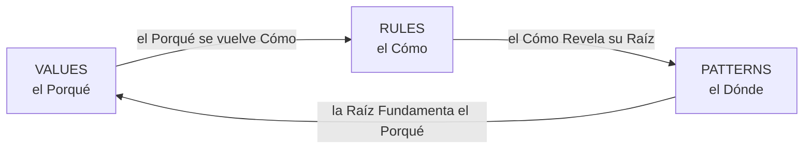
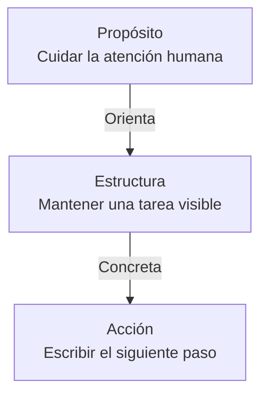
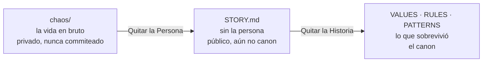

# Dove Canon

[English](README.md)

Dove Canon es un Harness para el trabajo compartido entre una Persona y un
Agente. Existe para proteger tu atención, y lo hace de tres maneras: mantiene
pequeño el siguiente Paso, mantiene el Estado fuera de tu cabeza y mantiene la
Máquina dentro de su Autoridad.

No va a usar toda capacidad que le des, y ese es justamente el punto. Cada
función extra es una cosa más que cargar en la mente antes de que te ayude.
**Más es un Costo antes que una Función.**

Este repositorio es un Manifiesto y una Base de código a la vez. Las Reglas
dicen cómo un Agente debe leer, escribir y colaborar aquí. Los Valores y
Patrones dicen por qué, para que puedas inspeccionar las razones y
discutirlas.

El Harness está hecho para volverse innecesario. Lo que debería quedar es el
Aprendizaje.

Estás en la entrada técnica. Si quieres saber por qué existen estas ideas, la
[Presentación](docs/presentation.es.md) cuenta esa historia. Esta página
muestra la arquitectura, las operaciones y los chequeos que las vuelven
concretas. Los documentos enlazados están en inglés, salvo la Presentación.

## Por dónde Empezar

- Para entender el Manifiesto, lee [Values](VALUES.md), [Rules](RULES.md) y
  [Patterns](PATTERNS.md).
- Para trabajar como Agente, empieza en [AGENTS.md](AGENTS.md) y luego lee
  [Rules](RULES.md).
- Para ver las Reglas en ejecución, abre el
  [servicio School](examples/school/README.md) o el
  [conversor PDF](examples/pdf/README.md).
- Para conectar otro proyecto, lee
  [Conectar otro proyecto](#conectar-otro-proyecto).

## Qué hace el Harness

Las sesiones son desechables. El Harness es lo que les sobrevive: guarda el
Contexto, acota lo que un Agente puede hacer a continuación y convierte la
experiencia repetida en un Canon que puedes inspeccionar.

```text
Persona      aporta intención, criterio y autoridad
Harness      guarda contexto, reglas, operaciones y límites
Agente       lee el estado actual y da un paso verificable
```

Una sesión normal es corta a propósito:

```text
yo-yo-yo          reconstruye el Contexto y nombra un siguiente Paso
gimme-gimme-gimme presenta hasta tres caminos y espera una elección
next-episode      ejecuta ese Paso, lo verifica y se detiene
remember-the-day  persiste el Estado mientras el Trabajo avanza
bye-bye-bye       deja un handoff que otra sesión pueda retomar
```

Los demás proyectos se conectan llevando juntos las skills, el agente y el
canon, como explica [Conectar otro proyecto](#conectar-otro-proyecto).

El conocimiento cruza el mismo tipo de frontera. La experiencia en bruto se
queda en `chaos/`. Una vez quitada la persona, lo que queda puede volverse una
Story. Solo el aprendizaje que sobrevive a la revisión se vuelve un Valor, una
Regla o un Patrón. El Sistema puede generar y comparar; la Persona decide qué
gobierna.

Los ejemplos son donde corren las Reglas de arquitectura. El servicio School se
genera desde un Contrato, una Especificación y una Forma que viven fuera de su
código, y sus versiones en Go, Java y TypeScript responden las mismas
solicitudes de la misma manera. El conversor PDF mantiene el parseo, la
estructura del documento y el renderizado detrás de fronteras que puedes
señalar con el dedo.

Lo que buscamos es un Trabajo que puedas entender, verificar y retomar después
de una interrupción.

## El Mapa del Repositorio

```text
VALUES.md   el Porqué      creencias, en values/
RULES.md    el Cómo        reglas verificables, en rules/
PATTERNS.md el Dónde       raíces que se repiten, en patterns/
AGENTS.md   el Puntero     lo que un agente carga solo
.agents/    agents/ y skills/, las operaciones
examples/   school/ en Go, Java y TypeScript, pdf/ en Go; specs/ guarda lo que los genera
docs/       la Presentación, en inglés y en español
stories/    STORY.md, stories/ y chaos/: contexto, aún no canon
jokes/      humor escrito a mano; se lee, y se deja como está
```

El resto de esta página sigue ese mapa. Primero el Manifiesto, después el
código que lo corre, y al final las operaciones que un Agente realiza aquí.

## El Manifiesto

Tres documentos lo sostienen: [Values](VALUES.md), [Rules](RULES.md) y
[Patterns](PATTERNS.md). [AGENTS.md](AGENTS.md) dirige al Agente hacia el Canon
actual y le indica leer primero las Reglas.

### Main es el único Canon

El Canon es el head de `main`, y nada más. Los releases estables nombran
snapshots útiles para distribuir, mientras `main` sigue siendo la fuente
actual. Si tu proyecto fija un release, estás siguiendo un Fork, y está bien
mientras lo sepas. `1.0.0` es el UNTAG histórico y `v1.0.0` es el primer
release estable. [The Head is the Canon](rules/the-head-is-the-canon.md)
explica por qué.

### Por qué todo viene de a tres

El tres sale de una cuenta. Con `n` entidades hay `n(n-1)/2` interacciones
posibles, y la comprensión vive en las interacciones.

| Entidades | Interacciones | Lectura |
| --- | --- | --- |
| 1 | 0 | Atención, nada que relacionar |
| 2 | 1 | Una relación, y un extremo se vuelve centro |
| 3 | 3 | Cada par visible, y el ciclo se cierra |
| 4 | 6 | Más relaciones que cosas |
| 5 | 10 | Las relaciones dejan de ser contables |

Tres es el último conteo donde ambas columnas coinciden y el menor que cierra
un ciclo. Trata el Número como una Fuente de la que derivar. Cuando una
situación tiene cuatro categorías, conserva las cuatro y dilo. Ver
[Three over Four](patterns/three-over-four.md) y
[Count me In](patterns/count-me-in.md).

El tres no le pide al Sistema que haga menos porque menos sea virtuoso.
Pregunta qué debe seguir Visible para que puedas entender, interrumpir y
continuar el Trabajo.

### Valores, Reglas y Patrones forman un ciclo

[RoTaTion](patterns/de-la-soul-rotation.md) conecta los tres documentos
mediante tres pares, sin centro fijo. Entra por cualquiera y sigue las
relaciones.



Una Regla debe poder ejecutarla un Agente, o es un Valor. Las Reglas son
verificables y los Valores son interpretables. Una Regla marcada
*Provisional* salió de una sola práctica, y el siguiente proyecto que la
contradiga la borra.

Una segunda lectura va del propósito a la acción en tres Capas:



### DeLaCase, la convención tipográfica

[DeLaCase](rules/de-la-case.md) gobierna la prosa de aquí. Una mayúscula marca
una Entidad o una Interacción digna de notarse, y la vas a ver en cada página
del Canon.

1. Divide el texto en pasajes según la puntuación; una viñeta o un salto de línea duro también cierra uno.
2. Gasta como máximo tres mayúsculas de énfasis por pasaje.
3. La inicial gramatical es gratis; los nombres propios y las siglas conservan su ortografía.

> La Persona Guía a la Máquina, la Máquina Apoya a la Persona.

Dos pasajes, cada uno con su propio presupuesto, cada uno gastando tres. Tres
es un techo, y la mayoría de los pasajes necesita menos.

El código tiene su propia regla: la capitalización de un identificador
pertenece al lenguaje, y el lenguaje decide. En Go, una mayúscula cruza la
frontera del paquete y el compilador lo hace cumplir. El texto final en una
interfaz de usuario usa capitalización ordinaria, y Dove en conversación
también.

La negrita es un segundo nivel y cuesta más: una por sección, o ninguna.
[Channels](rules/channels.md) cuenta lo que una superficie puede cargar, y
[Emoji](rules/emoji.md) marca un estado, uno por línea como máximo.

## El Código

Cada regla que gobierna código corre en [examples](examples).
[Show me the Code](patterns/show-me-the-code.md) explica por qué importa: una
regla que no puedes compilar es un Valor con nombre de Regla.

| Regla | Afirmación que se puede comprobar |
| --- | --- |
| [Layers](rules/layers.md) | El Core no nombra ningún vendor ni socket; el compilador sostiene la frontera. |
| [Providers](rules/providers.md) | El Core declara una interfaz; un Port se nombra por la necesidad, nunca por el vendor. |
| [Shapes](rules/shapes.md) | La entidad nunca es el DTO: Wire, Business y Storage son tres tipos. |
| [Failures](rules/failures.md) | Un fallo controlado lleva su respuesta; una sola función lo mapea a un status. |
| [Constants](rules/constants.md) | Las constantes globales van separadas de la configuración y se validan al arrancar. |
| [Scripts](rules/scripts.md) | Todo programa responde `build.sh` y `run.sh`, y cada uno rechaza lo que fallaría. |
| [Entrypoints](rules/entrypoints.md) | Las puertas se declaran en una lista; un shim solo llama a la lógica. |
| [Tests](rules/tests.md) | La expectativa se escribe explícita, y luego se prueba por mutación. |
| [Naming](rules/naming.md) | Verbo + Sustantivo + contexto, tres palabras como máximo. |
| [Structure](rules/structure.md) | Tres tiempos por función, no tres saltos de línea. |

### El servicio School

[School](examples/school/README.md) es una API generada desde un
[Contrato](examples/specs/school/openapi.yaml), una
[Especificación](examples/specs/school/SPEC.md) y una
[Forma](examples/specs/school/SHAPE.md). Go, Java y TypeScript se generan desde
las tres fuentes y responden cincuenta solicitudes límite con el mismo status,
content type y body. Cada uno mantiene tres formas para un mismo registro, así
el wire, el negocio y el almacenamiento se validan por separado.

| | Go | Java | TypeScript |
| --- | --- | --- | --- |
| Store | GORM sobre SQLite | JDBC sobre H2 | Drizzle sobre SQLite |
| Adaptadores | stdlib, chi, gin | stdlib, spring | stdlib, express |
| Chequeo de frontera | `go list -deps` | `BoundariesTest` | `boundaries.test.ts` |

Si quieres ver qué arreglan las reglas, [The Before](examples/school/BEFORE.md)
muestra el original con cada regla rota nombrada.

```text
main       arma los actores y elige un adaptador
adapters   los únicos archivos que importan un framework
handler    el guion: declaraciones de rutas y métodos handler
app        servicios, ports del store, el cruce, la forma y el caller
school     el núcleo de negocio: sin HTTP, sin driver
store      el único paquete que importa un ORM
campus     el registro y el aviso, una oficina que cumple ambos puertos
wire       el contrato, cada forma que un cliente envía o recibe
faults     fallos controlados, cada uno con su respuesta
settings   el cargador JSON estricto, validado al arrancar
```

```sh
cd examples/school/go
go list -deps ./school             # no lista ningún vendor ni net/http
./build.sh                         # gofmt, vet, test, luego el binario
TOKEN_SECRET=s ./run.sh gin        # stdlib, chi o gin
```

Un handler responde con un valor o falla. Armar la respuesta es trabajo de
otro:

```go
func (a Handler) ShowStudentRecord(req transport.Request) (any, error) {
	id, err := app.ReadPathNumber(req)
	if err != nil {
		return nil, err
	}

	student, err := a.School.ReadStudent(school.StudentID(id))
	if err != nil {
		return nil, err
	}

	return renderStudentView(student), nil
}
```

Once líneas, tres tiempos: recibir, transformar y devolver.

### El conversor PDF

[PDF](examples/pdf/README.md) renderiza el manifiesto de Markdown a PDF en Go
puro. `markdown/` es el único paquete que importa goldmark, y `render/` el
único que importa gopdf. `document/` y `style/` no importan ningún vendor, y
cinco funciones pequeñas convierten Markdown simple en un librito.

```sh
cd examples/pdf
./build.sh
./run.sh testdata/sample.md        # escribe sample.pdf al lado
```

### Chequeos que puedes correr

| Chequeo | Comando |
| --- | --- |
| Pares de traducción intactos | el loop de [Translations](rules/translations.md) no imprime nada |
| El Core no importa vendors | `go list -deps ./school` en `examples/school/go`; el test de frontera en `java/` y `ts/` |
| Los ejemplos compilan y pasan | `./build.sh` en cada directorio de ejemplo |

## Las Operaciones

Todo lo que hay bajo `.agents/` es algo que un Agente hace aquí: un agente,
Dove, y las skills que le dan nombre al trabajo recurrente.

### Dove da un paso acotado

[Dove](.agents/agents/dove.md) lee una explicación a través del manifiesto,
nombra el Patrón y da un paso acotado. Interpreta en lugar de revisar: no
devuelve hallazgos ni ordena nada por severidad.

| Pieza | Dónde |
| --- | --- |
| Estilo conversacional, usable por sí solo | [.agents/skills/cadencia-dove/SKILL.md](.agents/skills/cadencia-dove/SKILL.md) |
| Rol y flujo del agente | [.agents/agents/dove.md](.agents/agents/dove.md) |
| Shim para clientes que leen TOML | [.agents/agents/dove.toml](.agents/agents/dove.toml), que carga las fuentes del rol y el estilo |
| Herramientas | `Bash`, `Read`, `Grep`, `Glob`, `Edit`, `Write` |
| Identificador | `dove` en paths y configs, Dove en prosa |

El flujo es un filtro: cada paso quita lo que el siguiente no necesita.

1. **Escuchar** lee solo lo que el pedido nombra, y no pregunta nada que pueda leer.
2. **Ver** cuenta la Forma que se repite: una vez es un detalle, dos un hábito, tres un Patrón.
3. **Esbozar** señala como máximo dos lugares por desenredar, cada uno con su costo.
4. **Tirar** toma el primer hilo, nombra el paso anterior y el siguiente, y se detiene.

Cada turno es un cordel con tres nudos: **Tema**, **Perspectiva** y
**Remate**. Cuando le entregas tres hilos, tira de uno y nombra los otros dos.

Sus límites son explícitos:

- Edita solo lo que el turno nombró, un paso por turno.
- Sin revisión, sin reescribir un archivo completo en la respuesta, y sin normalizar las mayúsculas que recibió.
- Tras tres turnos de escritura o tres archivos tocados, considera [2-become-1](.agents/skills/2-become-1/SKILL.md).

También se enlaza al ciclo de vida de la sesión. Una edición duradera llama a
`remember-the-day`. Los saludos `ha dove`, `hey dove`, `yo dove`, `hi dove`,
`sup dove`, `ring dove` y `ring ring dove` llaman a `yo-yo-yo`. La despedida
`bye dove` llama a `bye-bye-bye`. Cuando una digresión deja pendiente el
propósito original, Dove ofrece `sexy back` para volver. En conversación usa
mayúsculas normales y deja que los tres tiempos guíen la respuesta sin repetir
sus etiquetas. El Quipu detrás de esa forma del turno se cuenta en la
[Presentación](docs/presentation.es.md).

Los nombres son canciones a propósito. `sexy back` recuerda *SexyBack* de
Justin Timberlake, porque un Quipu se puede enrollar, y `bye-bye-bye` recuerda
*Bye Bye Bye* de NSYNC, porque una despedida debería ser fácil de recordar.

### El primer benchmark encuentra brevedad, todavía no superioridad

Un benchmark preliminar pidió a vanilla, Caveman y Dove resumir seis cuentos
del dominio público en exactamente tres párrafos. El mismo runtime de Codex
basado en GPT-6 redactó todas las condiciones; el modelo servido exacto y el
esfuerzo no estaban expuestos. Los cuerpos se contaron con `tiktoken` 0.14.0 y
`o200k_base`, por lo que las cifras son un proxy consistente, no telemetría de
tokens facturados.

| Condición | Español | Inglés | Total |
| --- | ---: | ---: | ---: |
| Vanilla | 383 | 298 | 681 |
| Caveman | 314 | 241 | 555 |
| Dove | 303 | 248 | 551 |

Dove usó 19 % menos tokens que vanilla y 0,7 % menos que Caveman en total.
Caveman fue más corto en inglés; Dove fue más corto en español. Seis
borradores condicionados por estilo en una sola sesión no demuestran calidad
general, pero justifican una evaluación controlada con ejecuciones
independientes. Los prompts, fuentes, limitaciones y resultados completos están
en el [registro del benchmark](references/cadencia-dove-token-benchmark.md).

### Las skills le dan nombre al trabajo recurrente

Cada skill es una operación, y su archivo enlazado guarda los detalles.

| Cuándo | Skill | Qué hace |
| --- | --- | --- |
| `ha dove`, `hey dove`, `yo dove`, `hi dove`, `sup dove`, `ring dove`, `ring ring dove`, `catch me up`, `what remains?` o `where did we leave off?` | [yo-yo-yo](.agents/skills/yo-yo-yo/SKILL.md) | Sincroniza la rama, reconstruye el contexto y nombra un siguiente paso. |
| `what are our options?`, `where do we go from here?`, `what can we do next?` o `¿qué opciones tenemos?` | [gimme-gimme-gimme](.agents/skills/gimme-gimme-gimme/SKILL.md) | Presenta hasta tres caminos distintos y concretos; deriva los bloqueos a `say-no-go`. |
| Pide la voz conversacional de Dove o Cadencia Dove | [cadencia-dove](.agents/skills/cadencia-dove/SKILL.md) | Aplica el estilo y enmarcado de opciones sin necesitar al agente Dove. |
| `next`, `go`, `vamos`, `sigues`, `let's go`, `come on`, `sigue`, `continue`, `go on`, `go ahead`, `carry on`, `proceed`, `do the next step` u opción elegida | [next-episode](.agents/skills/next-episode/SKILL.md) | Da un paso recomendado, lo verifica y nombra el siguiente. |
| `sexy back`, `vuelve al origen`, `volvamos al tema original` o volver a donde empezó la conversación | [sexy-back](.agents/skills/sexy-back/SKILL.md) | Enrolla la digresión, conserva lo pendiente y retoma el propósito original. |
| `explain me like I'm five`, `ELI5`, `explícame como si tuviera 5 años` o pedir una explicación más simple | [eli5](.agents/skills/eli5/SKILL.md) | Explica una parte por turno con palabras simples, con un esquema cuando ayuda y una pregunta para sostener el hilo. |
| Una edición o decisión durable; `save progress` o `record where we are` | [remember-the-day](.agents/skills/remember-the-day/SKILL.md) | Guarda el hilo en `.handoff.md` durante el trabajo. |
| `move this thread to another repo` o `carry this work over` | [bye-bye-bye](.agents/skills/bye-bye-bye/references/transfer.md) | Entrega un `.handoff.md` listo para copiar; no hace falta la ruta de destino. |
| Cambia el código o un requisito cambia la forma de una app | [like-to-move-it](.agents/skills/like-to-move-it/SKILL.md) | Aplica las Rules de código y lee el flujo de diseño si el requisito cambia la forma de la app. |
| `I'm stuck`, `what's blocking us?`, `how do we get unstuck?`, `no estoy de acuerdo`, `dame otra perspectiva` o razonamiento repetido | [say-no-go](.agents/skills/say-no-go/SKILL.md) | Detiene el trabajo bloqueado o una respuesta discutida, nombra lo que falta y ofrece otro enfoque, otra perspectiva o volver a otro tema. |
| Un cambio empieza a crecer | [2-become-1](.agents/skills/2-become-1/SKILL.md) | Revisa si una sola intención aún sostiene el cambio. |
| Pedir las stories pendientes | [long-story-short](.agents/skills/long-story-short/SKILL.md) | Ordena las stories por lo que esperan y destila la que elijas. |
| Organizar cambios en commits por feature, separar el trabajo en commits o commitear y pushear | [commit-commit-commit](.agents/skills/commit-commit-commit/SKILL.md) | Agrupa cambios por feature, commitea cada grupo y pushea una vez al final. |
| `bye dove`, `I'm done for now`, `let's wrap up` o pedir un handoff | [bye-bye-bye](.agents/skills/bye-bye-bye/SKILL.md) | Expande el checkpoint en un handoff de cierre y se detiene. |
| Un secreto pudo entrar al historial, como una API key commiteada por error, o hay que quitar la marca de un vendor | [dirrty](.agents/skills/dirrty/SKILL.md) | Detecta, confirma y purga un valor exacto de archivos e historial; también quita la autoría de vendors como último recurso. |

Las skills de apoyo dan forma al trabajo mientras ocurre:
[cadencia-dove](.agents/skills/cadencia-dove/SKILL.md) para conversar,
[like-to-move-it](.agents/skills/like-to-move-it/SKILL.md) para código y diseño guiado por requisitos,
[de-la-case](.agents/skills/de-la-case/SKILL.md) para nombres y prosa, y
[til](.agents/skills/til/SKILL.md) para recoger los aprendizajes clave de la sesión.

El [Diagrama de Sesión](patterns/the-lever-and-the-tape.md) conecta estas
operaciones. Un pedido nuevo con su propia intención inicia su propio trabajo.
Abrir una sesión nombra el siguiente paso; publicar y cerrar necesitan cada
uno su propio pedido.

### Conectar otro proyecto

Las skills y el agente Dove funcionan como un conjunto, y los dos se apoyan en
el canon. Las skills citan [Reglas](RULES.md), [Valores](VALUES.md) y
[Patrones](PATTERNS.md) con links relativos, y el agente encamina el trabajo a
las skills. Llevarse una sin las otras la deja funcionando peor, así que
conecta las tres.

- **Clone o submodule.** Enlaza `.agents/skills` y `.agents/agents` en las
  carpetas de tu cliente, como hacen aquí `.claude/skills` y `.claude/agents`.
  Los links relativos siguen resolviendo, y
  [joining-you](.agents/skills/joining-you/SKILL.md) aplica una estructura
  documentada de ellos.
- **`npx skills add cangrejometralleta/dove-canon`.** Instala las skills y
  nada más, y `#v2.0.0` fija un release. Cada skill se copia sola, así que en
  una instalación limpia 69 de 121 links relativos se rompieron, y `dove.md` no
  se instaló. Las skills cargan igual; lo que citan no resuelve.

Conectes como conectes, revisa la carpeta y después pregúntale al cliente. La
carpeta prueba los links, y el cliente prueba que el Agente los cargó.

### La experiencia se gana un lugar en el Canon

Tres etapas llevan un pedazo de vida al canon, y solo la tercera se queda.



- Una creencia va a Values, una regla que un agente puede correr va a Rules, una raíz va a Patterns.
- Una story espera evidencia, trabajo aún en movimiento o una decisión: BLOCKED.
- Nueve Stories llenan el pasaje; se destila una antes de promover una décima.
- `chaos/` tiene su propio `.gitignore`, y solo su ejemplo se publica.
- En un proyecto de código, una decisión aterriza en `docs/`, una regla en código sostenido por un test, una promesa en el contrato de la API.

Un Stories vacío significa que el canon está al día.
[long-story-short](.agents/skills/long-story-short/SKILL.md) las ordena, una
por turno.

### Los agentes necesitan autoridad explícita

Un Agente necesita una Sociedad: autoridad explícita, señales independientes,
el derecho a detenerse y un humano a quien escalar.
[Coercion](rules/coercion.md) guarda las reglas. Nadie inventa permiso, nadie
toma represalias, y la presión no puede hacer parecer necesario un daño.

## El Nombre

**Dove** es el Agente; el **Canon** es el cuerpo compartido de Valores, Reglas y
Patrones que sigue. Juntos nombran este proyecto. El slug del repositorio es
`dove-canon`.

El nombre anterior, OneTwoThree, nació de *The Magic Number*, de De La Soul.
Su historia permanece en el [Mapa de procedencia](stories/provenance-map.md),
y el resto de la historia vive en la [Presentación](docs/presentation.es.md).

## Licencia

[MIT](LICENSE). Código y texto por igual — úsalo, adáptalo, compártelo, solo mantén el aviso de copyright.
