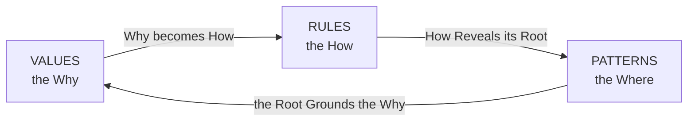
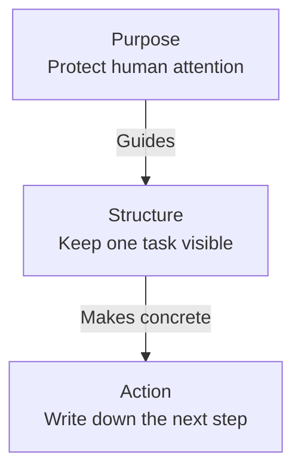
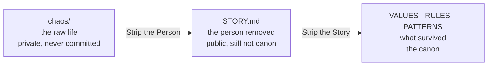

# Dove Canon

[Español](README.es.md)

Dove Canon is a Harness for work shared by a Person and an Agent.
It exists to protect your attention, and it does that in three ways:
keep the next Step small, keep the State outside your head,
and keep the Machine inside its Authority.

It will not use every capability you give it, and that is the point.
Every extra feature is one more thing to hold in mind before it helps you.
**More is a Cost before it is a Feature.**

This repository is a Manifesto and a Codebase at once. The Rules tell an
Agent how to read, write and collaborate here. The Values and Patterns say
why, so you can inspect the reasons and argue with them.

The Harness is meant to become unnecessary. What should remain is the Learning.

You are at the technical entrance. If you want to know why these ideas exist,
the [Presentation](docs/presentation.en.md) tells that story. This page shows
the architecture, the operations and the checks that make them concrete.

## Where to Start

- To understand the Manifesto, read [Values](VALUES.md), [Rules](RULES.md) and
  [Patterns](PATTERNS.md).
- To work as an Agent, start at [AGENTS.md](AGENTS.md), then read
  [Rules](RULES.md).
- To see the Rules run, open the [School service](examples/school/README.md) or
  the [PDF converter](examples/pdf/README.md).
- To connect another project, read
  [Connect another project](#connect-another-project).

## What the Harness Does

Sessions are disposable. The Harness is what survives them: it holds the
Context, bounds what an Agent may do next, and turns repeated experience into
Canon you can inspect.

```text
Person       supplies intention, judgment and authority
Harness      holds context, rules, operations and boundaries
Agent        reads the current state and takes one verifiable step
```

A normal session is short on purpose:

```text
yo-yo-yo          reconstruct Context and name one next Step
gimme-gimme-gimme frame up to three paths and wait for a choice
next-episode      execute that Step, verify it and stop
remember-the-day  persist State while the Work is moving
bye-bye-bye       leave a handoff another session can resume
```

Other projects connect by taking the skills, the agent and the Canon together,
as [Connect another project](#connect-another-project) explains.

Knowledge crosses the same kind of boundary. Raw experience stays in `chaos/`.
Once the person is removed, what is left may become a Story. Only the learning
that survives review becomes a Value, a Rule or a Pattern. The System may
generate and compare; the Person decides what governs.

The examples are where the architectural Rules run. The School service is
generated from a Contract, a Specification and a Shape that live outside its
code, and its Go, Java and TypeScript versions answer the same requests the
same way. The PDF converter keeps parsing, document structure and rendering
behind boundaries you can point at.

What we are after is Work you can understand, verify and pick up again after
an interruption.

## The Repository Map

```text
VALUES.md   the Why       beliefs, in values/
RULES.md    the How       verifiable rules, in rules/
PATTERNS.md the Where     recurring roots, in patterns/
AGENTS.md   the Pointer   what an agent loads on its own
.agents/    agents/ and skills/, the operations
examples/   school/ in Go, Java and TypeScript, pdf/ in Go; specs/ holds what generates them
docs/       the Presentation, in English and Spanish
stories/    STORY.md, stories/ and chaos/: context, not yet canon
jokes/      hand-written humour; read it, and leave it as it is
```

The rest of this page follows that map. First the Manifesto, then the code
that runs it, then the operations an Agent performs here.

## The Manifesto

Three documents hold it: [Values](VALUES.md), [Rules](RULES.md) and
[Patterns](PATTERNS.md). [AGENTS.md](AGENTS.md) points an Agent to the current
Canon and tells it to read Rules first.

### Main is the only Canon

The Canon is the head of `main`, and nothing else. Stable releases name
useful snapshots for distribution, while `main` remains the current truth. If
your project pins a release, you are following a Fork, and that is fine as
long as you know it. `1.0.0` is the historical UNTAG and `v1.0.0` is the
first stable release. [The Head is the Canon](rules/the-head-is-the-canon.md)
says why.

### Why everything comes in threes

Three comes from a count. With `n` entities there are `n(n-1)/2` possible
interactions, and understanding lives in the interactions.

| Entities | Interactions | Reading |
| --- | --- | --- |
| 1 | 0 | Attention, nothing to relate |
| 2 | 1 | One relationship, so one end becomes the center |
| 3 | 3 | Every pair visible, and a cycle closes |
| 4 | 6 | More relationships than things |
| 5 | 10 | The relationships stop being countable |

Three is the last count where both columns match and the smallest that closes
a cycle. Treat the Number as a Source to derive from. When a situation holds
four categories, keep all four and say so. See
[Three over Four](patterns/three-over-four.md) and
[Count me In](patterns/count-me-in.md).

Three does not ask the System to do less because less is virtuous. It asks
what must stay Visible for you to understand, interrupt and continue the Work.

### Values, Rules and Patterns form a cycle

[RoTaTion](patterns/de-la-soul-rotation.md) connects the three documents
through three pairs, with no fixed center. Enter through any of them and
follow the relationships.



A Rule must be executable by an Agent, or it is a Value. Rules are verifiable
and Values are interpretable. A Rule marked *Provisional* came from one
practice, and the next project that disagrees deletes it.

A second reading runs from purpose to action in three Layers:



### DeLaCase, the typographic convention

[DeLaCase](rules/de-la-case.md) governs the prose here. A capital marks an
Entity or an Interaction worth noticing, and you will see it on every page of
the Canon.

1. Split the text into passages at punctuation; a bullet or a hard line break also ends one.
2. Spend at most three emphasis capitals per passage.
3. The grammatical initial is free; proper names and acronyms keep their spelling.

> The Person Guides the Machine, the Machine Supports the Person.

Two passages, each with its own budget, each spending three. Three is a
ceiling, and most passages need fewer.

Code keeps its own rule: case in an identifier belongs to the language, and
the language decides. In Go, a capital crosses the package boundary and the
compiler enforces it. Final text in a user interface uses ordinary
capitalization, and so does Dove in conversation.

Bold is a second tier and costs more: one per section, or none.
[Channels](rules/channels.md) counts what a surface can carry, and
[Emoji](rules/emoji.md) marks a state, one per line at most.

## The Code

Every rule that governs code runs in [examples](examples).
[Show me the Code](patterns/show-me-the-code.md) says why that matters: a
rule you cannot compile is a Value wearing a Rule's name.

| Rule | Claim you can check |
| --- | --- |
| [Layers](rules/layers.md) | The Core names no vendor and no socket; the compiler holds the boundary. |
| [Providers](rules/providers.md) | The Core declares an interface; a Port is named for the need, never the vendor. |
| [Shapes](rules/shapes.md) | The entity is never the DTO: Wire, Business and Storage are three types. |
| [Failures](rules/failures.md) | A controlled failure carries its answer; one function maps it to a status. |
| [Constants](rules/constants.md) | Global constants are separate from configuration and validated at startup. |
| [Scripts](rules/scripts.md) | Every program answers `build.sh` and `run.sh`, and each refuses what would fail. |
| [Entrypoints](rules/entrypoints.md) | Doors are declared in one list; a shim only calls the logic. |
| [Tests](rules/tests.md) | The expectation is spelled out, then proven by mutation. |
| [Naming](rules/naming.md) | Verb + Noun + context, three words at most. |
| [Structure](rules/structure.md) | Three beats per function, not three newlines. |

### The School service

[School](examples/school/README.md) is one API, generated from a
[Contract](examples/specs/school/openapi.yaml), a
[Specification](examples/specs/school/SPEC.md) and a
[Shape](examples/specs/school/SHAPE.md). Go, Java and TypeScript are each
generated from all three, and answer fifty edge requests with the same status,
content type and body. Each keeps three shapes for one record, so the wire,
the business and the storage validate apart.

| | Go | Java | TypeScript |
| --- | --- | --- | --- |
| Store | GORM over SQLite | JDBC over H2 | Drizzle over SQLite |
| Adapters | stdlib, chi, gin | stdlib, spring | stdlib, express |
| Boundary check | `go list -deps` | `BoundariesTest` | `boundaries.test.ts` |

If you want to see what the rules fix, [The Before](examples/school/BEFORE.md)
shows the original with each broken rule named.

```text
main       casts the players and picks an adapter
adapters   the only files that import a framework
handler    the script: route declarations and handler methods
app        services, store ports, the crossing, form and caller
school     the business core: no HTTP, no driver
store      the only package that imports an ORM
campus     the registry and the notice, one office filling both ports
wire       the contract, every shape a client sends or receives
faults     controlled failures, each carrying its answer
settings   the strict JSON loader, validated at startup
```

```sh
cd examples/school/go
go list -deps ./school             # lists no vendor and no net/http
./build.sh                         # gofmt, vet, test, then the binary
TOKEN_SECRET=s ./run.sh gin        # stdlib, chi or gin
```

A handler answers with a value or fails. Building the reply is somebody
else's job:

```go
func (a Handler) ShowStudentRecord(req transport.Request) (any, error) {
	id, err := app.ReadPathNumber(req)
	if err != nil {
		return nil, err
	}

	student, err := a.School.ReadStudent(school.StudentID(id))
	if err != nil {
		return nil, err
	}

	return renderStudentView(student), nil
}
```

Eleven lines, three beats: receive, transform and return.

### The PDF converter

[PDF](examples/pdf/README.md) renders the manifesto from Markdown to PDF in
pure Go. `markdown/` is the only package that imports goldmark, `render/` the
only one that imports gopdf. `document/` and `style/` import no vendor, and
five small functions turn plain Markdown into a booklet.

```sh
cd examples/pdf
./build.sh
./run.sh testdata/sample.md        # writes sample.pdf beside it
```

### Checks you can run

| Check | Command |
| --- | --- |
| Translation pairs intact | the loop in [Translations](rules/translations.md) prints nothing |
| Core imports no vendor | `go list -deps ./school` in `examples/school/go`; the boundary test in `java/` and `ts/` |
| Examples build and pass | `./build.sh` in each example directory |

## The Operations

Everything under `.agents/` is something an Agent does here: one agent, Dove,
and the skills that give recurring work a name.

### Dove takes one bounded step

[Dove](.agents/agents/dove.md) reads an explanation through the manifesto,
names the Pattern and takes one bounded step. It interprets rather than
reviews: it returns no findings and ranks nothing by severity.

| Piece | Where |
| --- | --- |
| Conversation style, usable alone | [.agents/skills/cadencia-dove/SKILL.md](.agents/skills/cadencia-dove/SKILL.md) |
| Agent role and workflow | [.agents/agents/dove.md](.agents/agents/dove.md) |
| Shim for clients that read TOML | [.agents/agents/dove.toml](.agents/agents/dove.toml), which loads the role and style sources |
| Tools | `Bash`, `Read`, `Grep`, `Glob`, `Edit`, `Write` |
| Identifier | `dove` in paths and configs, Dove in prose |

The workflow is a filter: each step removes what the next one does not need.

1. **Listen** reads only what the request names, and asks nothing it can read.
2. **See** counts the Shape that repeats: once is a detail, twice a habit, three times a Pattern.
3. **Sketch** points to at most two places to untangle next, each with its cost.
4. **Pull** takes the first thread, names the step before and after, and stops.

Every turn is one cord with three knots: **Topic**, **Perspective** and
**Closing**. When you hand it three threads, it pulls one and names the other
two.

Its bounds are explicit:

- Edit only what the turn named, one step per turn.
- No review, no whole-file rewrite in the answer, and no normalizing of the capitals it was given.
- After three writing turns or three files touched, consider [2-become-1](.agents/skills/2-become-1/SKILL.md).

It also hooks the session lifecycle. A durable edit calls `remember-the-day`.
The greetings `ha dove`, `hey dove`, `yo dove`, `hi dove`, `sup dove`,
`ring dove` and `ring ring dove` call `yo-yo-yo`. The farewell `bye dove`
calls `bye-bye-bye`. When a detour leaves the original purpose pending, Dove
offers `sexy back` to return. In conversation it uses ordinary capitalization
and lets the three beats guide the answer without repeating their labels. The
Quipu behind that turn shape is told in the
[Presentation](docs/presentation.en.md).

The names are songs on purpose. `sexy back` recalls *SexyBack* by Justin
Timberlake, because a Quipu can be rolled up, and `bye-bye-bye` recalls
*Bye Bye Bye* by NSYNC, because a farewell should be easy to remember.

### The first benchmark finds brevity, not yet superiority

A preliminary benchmark asked vanilla, Caveman and Dove to summarize six
public-domain stories in exactly three paragraphs. The same GPT-6-based Codex
runtime drafted every condition; its exact serving model and effort were not
exposed. Summary bodies were counted with `tiktoken` 0.14.0 and `o200k_base`,
so these figures are a consistent proxy rather than billed-token telemetry.

| Condition | Spanish | English | Total |
| --- | ---: | ---: | ---: |
| Vanilla | 383 | 298 | 681 |
| Caveman | 314 | 241 | 555 |
| Dove | 303 | 248 | 551 |

Dove used 19% fewer tokens than vanilla and 0.7% fewer than Caveman overall.
Caveman was shorter in English; Dove was shorter in Spanish. Six
style-conditioned drafts from one session cannot establish general quality,
but they justify a controlled evaluation with independent runs. The complete
prompts, sources, limitations and outputs live in the
[benchmark record](references/cadencia-dove-token-benchmark.md).

A second run used Sonnet at high effort, real token counts and a judge. Caveman
wrote the shortest visible text, 46% under vanilla on summaries against 24% for
the full Cadencia and 31% for the mini. Quality barely moved: every summary kept
its events, causes and ending, and faithfulness stayed within 1.42 to 1.75 of
2. DeLaCase on by default made the mini think far longer, so its total output
rose above vanilla; with DeLaCase off it stayed below. The
[second run](references/cadencia-dove-token-benchmark.md#second-run-sonnet-at-high-effort-five-conditions-with-a-quality-check)
lists its limits, among them twelve summaries per condition and a single judge.

### Skills give recurring work a name

Each skill is one operation, and its linked file holds the details.

| When | Skill | What it does |
| --- | --- | --- |
| `ha dove`, `hey dove`, `yo dove`, `hi dove`, `sup dove`, `ring dove`, `ring ring dove`, `catch me up`, `what remains?` or `where did we leave off?` | [yo-yo-yo](.agents/skills/yo-yo-yo/SKILL.md) | Syncs the project branch, rebuilds context and names one next step. |
| `what are our options?`, `where do we go from here?`, `what can we do next?` or `¿qué opciones tenemos?` | [gimme-gimme-gimme](.agents/skills/gimme-gimme-gimme/SKILL.md) | Frames up to three distinct, grounded paths; routes blockers to `say-no-go`. |
| Ask to speak in Dove's voice or use Cadencia Dove | [cadencia-dove](.agents/skills/cadencia-dove/SKILL.md) | Applies Dove's conversational style and option framing without requiring the Dove agent. |
| Ask for Dove's short style or fewer tokens | [cadencia-dove-mini](.agents/skills/cadencia-dove-mini/SKILL.md) | A compact Cadencia Dove with DeLaCase on request and no links. `npx skills add cangrejometralleta/dove-canon --skill cadencia-dove-mini` installs it alone. |
| `next`, `go`, `vamos`, `sigues`, `let's go`, `come on`, `sigue`, `continue`, `go on`, `go ahead`, `carry on`, `proceed`, `do the next step` or a selected option | [next-episode](.agents/skills/next-episode/SKILL.md) | Takes one recommended step, verifies it and names the following one. |
| `sexy back`, `vuelve al origen`, `volvamos al tema original` or return to where the conversation started | [sexy-back](.agents/skills/sexy-back/SKILL.md) | Rolls up the digression, preserves what remains pending and resumes the original purpose. |
| `explain me like I'm five`, `ELI5`, `explícame como si tuviera 5 años` or ask for a simpler explanation | [eli5](.agents/skills/eli5/SKILL.md) | Explains one part per turn in plain words, with a schema when it helps and a question to keep the thread. |
| A durable edit, decision or validation; `save progress` or `record where we are` | [remember-the-day](.agents/skills/remember-the-day/SKILL.md) | Saves the thread in `.handoff.md` during work. |
| `move this thread to another repo` or `carry this work over` | [bye-bye-bye](.agents/skills/bye-bye-bye/references/transfer.md) | Returns a copy-ready `.handoff.md`; no destination path is needed. |
| Code changes or a requirement changes an app's shape | [like-to-move-it](.agents/skills/like-to-move-it/SKILL.md) | Applies code Rules and reads its design Workflow when a requirement changes the app's shape. |
| `I'm stuck`, `what's blocking us?`, `how do we get unstuck?`, `I disagree`, `give me another perspective` or reasoning repeats | [say-no-go](.agents/skills/say-no-go/SKILL.md) | Stops blocked work or a disputed answer, names what is missing and offers another approach, perspective or return to another topic. |
| A change starts growing | [2-become-1](.agents/skills/2-become-1/SKILL.md) | Checks whether one intent still holds the change. |
| Ask for pending stories | [long-story-short](.agents/skills/long-story-short/SKILL.md) | Sorts stories by what they wait on and distills the one you pick. |
| Organize local changes into feature commits, split work into commits, or commit and push the changes | [commit-commit-commit](.agents/skills/commit-commit-commit/SKILL.md) | Groups changes by feature, commits each group, pushes once after all succeed. |
| `bye dove`, `I'm done for now`, `let's wrap up` or request a handoff | [bye-bye-bye](.agents/skills/bye-bye-bye/SKILL.md) | Expands the checkpoint into a closing handoff and stops. |
| A secret may have entered history, such as an accidentally committed API key, or a vendor needs debranding | [dirrty](.agents/skills/dirrty/SKILL.md) | Detects, confirms and purges an exact value from files and history; also debrands vendor authorship as a last resort. |

Supporting skills shape the work as it happens:
[cadencia-dove](.agents/skills/cadencia-dove/SKILL.md) for conversation,
[like-to-move-it](.agents/skills/like-to-move-it/SKILL.md) for code and requirement-led design,
[de-la-case](.agents/skills/de-la-case/SKILL.md) for names and prose, and
[til](.agents/skills/til/SKILL.md) for a session's key learnings.

The [Session Diagram](patterns/the-lever-and-the-tape.md) connects these
operations. A new request with its own intent starts its own work. Opening a
session names the next step; publication and closing each need their own
request.

### Connect another project

The skills and the Dove agent work as one set, and both lean on the Canon.
Skills cite [Rules](RULES.md), [Values](VALUES.md) and [Patterns](PATTERNS.md)
by relative link, and the agent routes the work to the skills. Taking one
without the others leaves it working worse, so connect all three.

- **Clone or submodule.** Link `.agents/skills` and `.agents/agents` into your
  client's folders, as `.claude/skills` and `.claude/agents` do here. The
  relative links keep resolving, and [joining-you](.agents/skills/joining-you/SKILL.md)
  applies a documented layout of them.
- **`npx skills add cangrejometralleta/dove-canon`.** It installs the skills
  and nothing else, and `#v2.0.1` pins a release. Each skill is copied alone,
  so in a clean install 65 of 106 relative links broke, and `dove.md` was not
  installed. The skills still load; what they cite does not resolve.

Whichever way you connect, check the folder and then ask the client. The
folder proves the links, and the client proves the Agent loaded them.

### Experience earns its way into the Canon

Three stages carry a piece of life into the canon, and only the third one
stays.



- A belief goes to Values, a rule an agent can run goes to Rules, a root goes to Patterns.
- A story waits on evidence, on work still moving, or on a decision: BLOCKED.
- Nine Stories fill the passage; distill one before promoting a tenth.
- `chaos/` has its own `.gitignore`, and only its example ships.
- In a code project a decision lands in `docs/`, a rule in code held by a test, a promise in the API contract.

An empty Stories means the canon is current.
[long-story-short](.agents/skills/long-story-short/SKILL.md) sorts them, one
per turn.

### Agents need explicit authority

An Agent needs a Society: explicit authority, independent signals, the right
to stop and a human to escalate to. [Coercion](rules/coercion.md) holds the
rules. Nobody invents permission, nobody retaliates, and pressure is not
allowed to make harm look necessary.

## The Name

**Dove** is the Agent; the **Canon** is the shared body of Values, Rules and
Patterns it follows. Together they name this project. Its repository slug is
`dove-canon`.

The former name, OneTwoThree, drew on De La Soul's *The Magic Number*. Its
history remains in the [Provenance Map](stories/provenance-map.md), and the
rest of the story lives in the [Presentation](docs/presentation.en.md).

## License

[MIT](LICENSE). Code and prose alike — use it, adapt it, share it, just keep the copyright notice.
