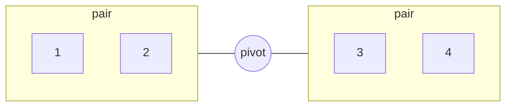

# The Geometry of Grouping

- A Count is not neutral.  
  It Depends on the level you Group at.
- Five is two pairs and one loose element.  
  The loose one Rotates, and each turn shows other pairs.
- Seven is three pairs and one loose,  
  or two threes and one loose. The loose one Chooses the Geometry.
- Every odd Number Scales the same way: pairs and one loose.  
  Three, Five and Seven are one Reasoning at different Sizes.
- The loose element is not a remainder. It is the Perspective,  
  the Node that Holds a Position no group occupies.

- Five travel in a car as one and two pairs.  
  Each pair Talks within itself, and the one can Ride in Silence.
- Asked to explain like to a five-year-old, an Agent Chose five stages  
  on its own; the skill Names no Count.
- Nobody Searched for either.  
  The Shape Arrived where nobody Asked for it.
