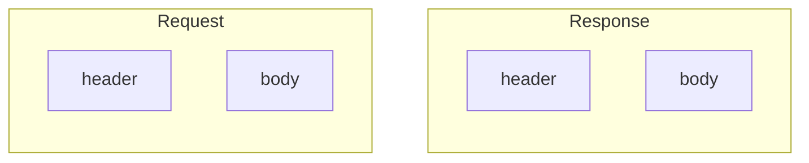
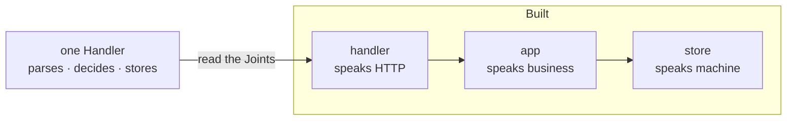

# Grouping

> Provisional. Written from practice, not yet Weathered.

- Four is four, or two times two; the Abstraction Decides.  
  The Check is not the number. It is where the Grouping comes from.
- Count at the Joints the Work already Built.  
  A Joint is a seam the material already Has:  
  the comma in a sentence, a boundary of responsibility,  
  two items closer to each other than to the rest.  
  Remove it, and the two sides stop making sense.
- The Bias Runs both ways.  
  Forcing a fourth into three Imposes a Shape;  
  trimming a three to two, to look unbiased, Imposes one too.
- In an odd Count, find the pairs first.  
  Let the loose one Choose the Geometry, and keep it as the Perspective.

Four, read as two times two. One Exchange has two Joints;
cut by Direction or cut by Part, and the pairs differ.

- The same Geometry Works in reverse.  
  A complex System, read by its Joints, Breaks into simpler Entities;  
  the Shape you Found becomes the Structure you Build.

The Pattern Lives in [The Geometry of Grouping](../patterns/the-geometry-of-grouping.md).
