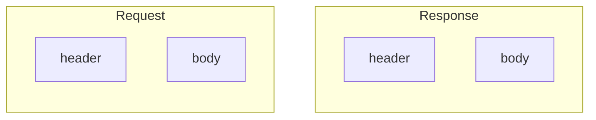
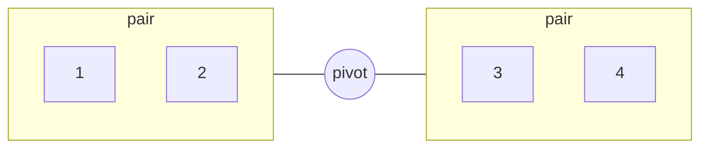
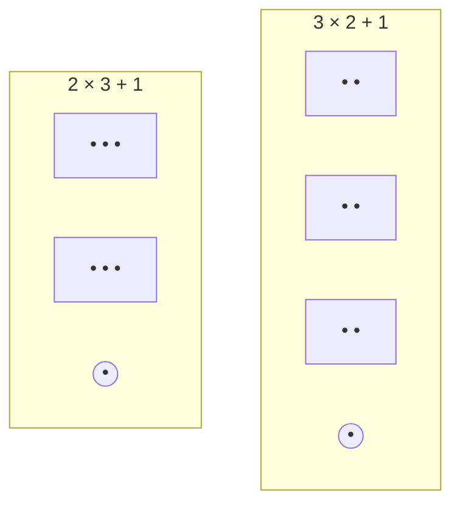
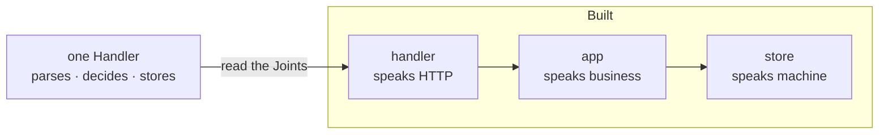

# The Geometry of Grouping (SPECULATIVE)

A Count is not neutral. It Depends on the level you Group at.
Four is four, or two times two; the Abstraction Decides.

The Bias Runs both ways.  
Forcing a fourth into three Imposes a Shape;  
trimming a three to two, to look unbiased, Imposes one too.

The Check is not the number. It is where the Grouping comes from:  
Count at the Joints the Work already Built.

- A Joint is a seam the material already Has:  
  the comma in a sentence, a boundary of responsibility,  
  two items closer to each other than to the rest.  
  Remove it, and the two sides stop making sense.
- Five is two pairs and one loose element.  
  The loose one Rotates, and each turn shows other pairs.
- Seven is three pairs and one loose,  
  or two threes and one loose. The loose one Chooses the Geometry.
- The loose element is not a remainder. It is the Perspective,  
  the Node that Holds a Position no group occupies.
- The same Geometry Works in reverse.  
  A complex System, read by its Joints, Breaks into simpler Entities;  
  the Shape you Found becomes the Structure you Build.

## Schemas

Four, read as two times two. One Exchange has two Joints;
cut by Direction or cut by Part, and the pairs differ.

Five, two pairs and a Pivot. Turn the Pivot, and the pairs Change.

Seven, two Geometries of the same Seven. The loose one Chooses.

In reverse: a tangled Service, read by its Joints,
Breaks into three simpler Entities.

Open: is this a Pattern beside `the-node-outside-your-head.md`,
a Rule for grouping in design, or both?
Do the Schemas it implies (pairs plus a pivot) Repeat in code?

Distill when a second Domain groups the same way, unsearched.
